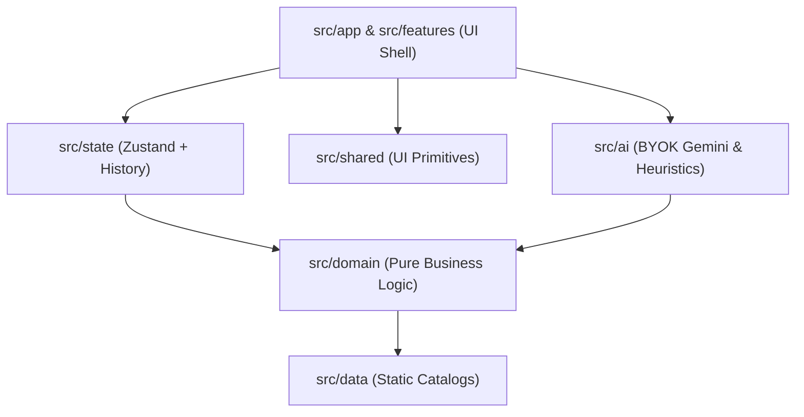

# Jubilee - GenAI Celebration & Event Planner

Live demo: https://akshayjadhav237237-cmd.github.io/jubilee-event-planner/  
License: MIT

Jubilee is an offline-capable, privacy-first web application designed to help everyday hosts plan milestone celebrations—from weddings and milestone birthdays to community cultural festivals. It combines deterministic financial arithmetic, structured milestone timelines, and vendor negotiation playbooks with local-first AI assistance and optional Google Gemini generative intelligence.

```bash
# Quick Start
npm ci
npm run dev
npm run check
```

---

## 1. Chosen Vertical and Persona

### Chosen Vertical: Celebrations & Milestone Events

Milestone celebrations represent high-stakes emotional and financial commitments for non-professional organizers. Unlike corporate conferences, celebrations involve personal funds, emotionally charged trade-offs, family dynamics, strict accessibility needs, and volatile vendor contracts.

### Target Personas

1. **The Self-Planning Couple (Weddings & Receptions)**: Managing complex multi-generational guest lists, banquet caterers, floral decor, and strict budgets across INR, USD, EUR, or GBP without paying luxury agency retainers.
2. **The Everyday Family Host (Milestone Birthdays & Anniversaries)**: Organizing 10th or 50th birthday parties with tight timelines, kid-friendly entertainment, sensory considerations, and surprise schedules.
3. **The Neighborhood Lead (Community & Cultural Festivals)**: Coordinating volunteer-driven street festivals, cultural fairs, and block celebrations requiring municipal permits, sanitation plans, AV logistics, and contingency reserves.

### Pre-loaded Demo Scenarios

Jubilee includes 3 verified end-to-end demo scenarios pre-configured with authentic budget allocations, dates, and priorities:

- **Ananya & Rohan's Wedding**: 250 guests, traditional banquet celebration, ₹25,00,000 budget, hybrid indoor/outdoor setting with elderly and dietary accessibility requirements.
- **Aarav's 10th Birthday**: 35 guests, kids party celebration, ₹75,000 budget, indoor magic show and games with surprise party timeline.
- **Indiranagar Cultural Festival**: 500 attendees, cultural festival, ₹5,00,000 budget, outdoor community grounds with waste management, AV equipment, and security permits.

---

## 2. Approach and Logic

### Clean Architecture & Layered Boundaries

Jubilee follows strict unidirectional dependency boundaries:



### Layer Dependency Rules

- `src/domain`: Pure TypeScript domain logic, types, budget math, and commands. Zero React, zero Zustand, zero DOM, zero network calls.
- `src/data`: Static catalogs (19 categories, 108 ideas, 61 tasks, 27 vendor guides, 3 budget presets, 17 adaptation rules). Depends only on domain types.
- `src/ai`: AI ports, security guards, disclosure filters, BYOK Gemini client adapter, and local deterministic heuristics. Zero React components.
- `src/state`: Zustand stores, command execution, undo/redo history stacks, and localStorage persistence. Zero React UI components.
- `src/features/<name>`: Isolated UI feature modules (`intake`, `budget`, `timeline`, `vendors`, `ideas`, `assistant`, `export`, `print`, `reset`). Never imports across features.
- `src/shared`: Shared UI primitives (buttons, dialogs, badges, cards, inputs) and utilities (`cx`, `result`, `money`, `dates`).
- `src/app`: Composition root, top-level application shell, landmarks, and tab routing.

### Deterministic Financial Arithmetic

Budgets are represented strictly in integer minor units (paise or cents) to prevent IEEE 754 floating-point drift. Category allocations use the largest-remainder method (Hamilton-Hare quota) to guarantee that distributed sums equal the exact total budget without losing a single paisa. Configurable contingency reserves (0% to 15%) are reserved before category apportionment.

### Command Pattern & Undo/Redo Engine

All user modifications—task additions, category adjustments, vendor quote logs, and idea bookmarks—are dispatched as typed `Command` objects. The domain reducer and state store dispatch and `execute()` commands against the immutable event plan, maintaining a snapshot history stack with bidirectional `undo()` and `redo()` actions accessible from the workspace toolbar.

---

## 3. How the Solution Works

### Workspace Engines

- **Intake & Launchpad**: Rapid questionnaire capturing event type, guest count, total budget, target date, setting, and flags (kids, elders, dietary, accessibility, music, open bar).
- **Budget Allocation Engine**: Calculates baseline allocations across 19 canonical categories using 3 curated event presets (wedding: 10 categories, birthday: 8 categories, community: 9 categories). Supports real-time category rebalancing and contingency rate tuning.
- **Timeline & Milestones Engine**: Generates scheduled checklists from 61 task templates (18 wedding, 14 birthday, 15 community, 14 conditional). Resolves dependencies, tracks completion statuses, and highlights overdue milestones.
- **Vendor Playbooks**: 27 vendor negotiation guides providing question checklists, red flags to avoid, and contract review clauses. Includes quote comparison tracking with commitment status and contract notes.
- **Inspiration & Moodboard**: 108 curated celebration ideas (36 themes, 36 menus, 36 activities) filtered and adapted to event constraints through 17 rule-based adaptation heuristics.

### Privacy Architecture & AI Disclosure Boundary

Jubilee implements an explicit privacy boundary. When communicating with generative AI providers, sensitive details are withheld, and only sanitized planning parameters are transmitted:

| Field Name          | Category            | Transmission Status | Rationale                                      |
| :------------------ | :------------------ | :------------------ | :--------------------------------------------- |
| `eventType`         | Event Context       | Disclosed           | Required for thematic planning                 |
| `subFormat`         | Event Context       | Disclosed           | Tailors formality and scale                    |
| `guestCount`        | Sizing Parameter    | Disclosed           | Scales catering and seating recommendations    |
| `currency`          | Localization        | Disclosed           | Formats financial outputs                      |
| `totalBudget`       | Financial Scope     | Disclosed           | Calibrates budget tier suggestions             |
| `setting`           | Environmental       | Disclosed           | Guides weather contingency advice              |
| `flags`             | Special Needs       | Disclosed           | Accommodates dietary, elder, or child needs    |
| `priorities`        | Strategic Focus     | Disclosed           | Aligns suggestions with host goals             |
| `daysUntilEvent`    | Schedule Relative   | Disclosed           | Informs milestone urgency without exact dates  |
| `categories`        | Budget Structure    | Disclosed           | Shows allocated category breakdown             |
| `tasks`             | Progress Summary    | Disclosed           | Identifies pending milestones                  |
| `sanitizedUserText` | User Prompt         | Disclosed           | Filtered user input without injected secrets   |
| `title`             | Personal Identity   | **Withheld**        | Kept client-side only                          |
| `exactEventDate`    | PII / Calendar      | **Withheld**        | Preserves calendar privacy; relative days sent |
| `vendorNames`       | Business Privacy    | **Withheld**        | Protects specific vendor identities            |
| `vendorQuotes`      | Financial PII       | **Withheld**        | Private quote figures remain local             |
| `actualSpend`       | Financial PII       | **Withheld**        | Sensitive payment tracking kept in browser     |
| `savedIdeas`        | Personal Scrapbook  | **Withheld**        | Host personal selections remain local          |
| `apiKey`            | Security Credential | **Withheld**        | BYOK keys never exposed to prompts or logs     |

### Export, Interoperability & Security

- **Calendar (.ics) Export**: RFC 5545 compliant calendar feed with line folding, stable UIDs, and all-day milestone schedules.
- **Spreadsheet (.csv) Export**: Complete financial breakdowns protected against CSV formula injection by quoting and prepending single-quotes to dangerous prefixes (`=`, `+`, `-`, `@`, `\t`, `\r`).
- **Markdown Brief**: Formatted celebration brief for sharing with family, co-hosts, or vendors.
- **JSON Backup & Migration**: Schema-validated import/export with backward-compatible migrations.
- **Print Layout**: Dedicated `@media print` stylesheets for clean single-page briefing sheets.

### Developer Workflow & NPM Scripts

| Script          | Command                                                                                                               | Purpose                                                  |
| :-------------- | :-------------------------------------------------------------------------------------------------------------------- | :------------------------------------------------------- |
| `dev`           | `vite`                                                                                                                | Start local Vite development server                      |
| `build`         | `tsc -b && vite build`                                                                                                | Typecheck TypeScript and compile production bundle       |
| `preview`       | `vite preview`                                                                                                        | Serve production build locally                           |
| `typecheck`     | `tsc --noEmit`                                                                                                        | Strict TypeScript compiler check without emitting output |
| `lint`          | `eslint .`                                                                                                            | Execute ESLint across all source and test files          |
| `format`        | `prettier --write .`                                                                                                  | Format all code, documentation, and config files         |
| `format:check`  | `prettier --check .`                                                                                                  | Verify Prettier code style compliance                    |
| `test`          | `vitest run`                                                                                                          | Run automated test suite                                 |
| `test:coverage` | `vitest run --coverage`                                                                                               | Run test suite with V8 code coverage report              |
| `knip`          | `knip`                                                                                                                | Detect unused dependencies, files, and exports           |
| `check`         | `npm run typecheck && npm run lint && npm run format:check && npm run test:coverage && npm run knip && npm run build` | Full quality contract gatekeeper verification            |

---

## 4. Assumptions Made

### Operational Boundaries & Limitations

- **Heuristic Floors**: Note that heuristic floors are planning baselines not vendor commitments. Real-world vendor rates vary by city, seasonality, and market volatility.
- **Client-Side Privacy**: Jubilee provides fully client-side operation using browser localStorage. No user event data is transmitted to or stored on remote application servers.
- **GitHub Pages CSP Enforcement**: Because GitHub Pages cannot emit HTTP response headers so CSP is enforced via build-time HTML meta tag placed as the very first child of `<head>`.
- **Search Engine Root Crawler Caveat**: Because search engines read robots.txt only at domain root, in subpath deployments such as `https://akshayjadhav237237-cmd.github.io/jubilee-event-planner/`, crawler files are provided at the distribution root (`public/robots.txt` and `public/sitemap.xml`) for mirror and direct indexing.
- **Zero-Dependency Security**: The application embeds zero third-party analytics trackers, zero external advertising scripts, and zero remote CDNs.

---

## 5. Evaluation Focus

### Quality Contract Adherence

- Strict file length limits: Maximum 200 lines per file (enforced by ESLint `max-lines`), max 60 lines per function, and max 90 lines per TSX component.
- Strict TypeScript: `strict: true`, `noUncheckedIndexedAccess: true`, `exactOptionalPropertyTypes: true`, `noImplicitOverride: true`, `verbatimModuleSyntax: true`.
- Zero compiler and linter bypasses: No `any`, no non-null assertions (`!`), no `@ts-ignore`, and no `eslint-disable` annotations.
- Named exports only across all source modules (`src/`). Config files are exempt.
- Functional boundary contracts: All cross-boundary domain operations return `Result<T, E>` types rather than throwing unchecked exceptions.
- Zero console logging (`no-console` ESLint rule).

### Testing Strategy & Verified Catalog Counts

The automated test suite covers 78 test suites across key verification categories:

- **Unit Tests**: Domain arithmetic, date calculations, invertible commands, input sanitization, UI primitives.
- **Integration Tests**: Store reducer transitions, history undo/redo stacks, AI port fallback heuristics.
- **Axe Accessibility Tests**: Automated `axe-core` accessibility audits across App Shell, Launchpad, and all feature panels, verifying zero WCAG 2.1 AA violations.
- **Round-Trip Persistence Tests**: LocalStorage serialization, schema version migrations, and corrupted payload self-healing.
- **Formula Injection Tests**: Validating spreadsheet defense against formula execution payloads.
- **Docs & SEO Assertion Tests**: Automated verification of README facts, HTML metadata, Open Graph attributes, and PNG binary structure.

### Verified Architecture Counts

- **3** pre-loaded demo scenarios (`DEMO_SCENARIOS`)
- **3** budget presets (`BUDGET_PRESETS`: wedding, birthday, community)
- **19** canonical budget categories (`CATEGORIES`)
- **108** curated celebration ideas (`ALL_IDEAS`: 36 themes, 36 menus, 36 activities)
- **61** task templates (`ALL_TASKS`: 18 wedding, 14 birthday, 15 community, 14 conditional)
- **27** vendor negotiation playbooks (`ALL_VENDOR_GUIDES`)
- **17** adaptation heuristics (`ALL_ADAPTATION_RULES`)
- **12** AI disclosure fields (`AI_DISCLOSURE_FIELDS`)
- **7** AI withheld privacy fields (`AI_WITHHELD_FIELDS`)
- **4** supported currencies (`INR`, `USD`, `EUR`, `GBP`)
- **11** verified NPM development scripts
- **78** automated test suites
